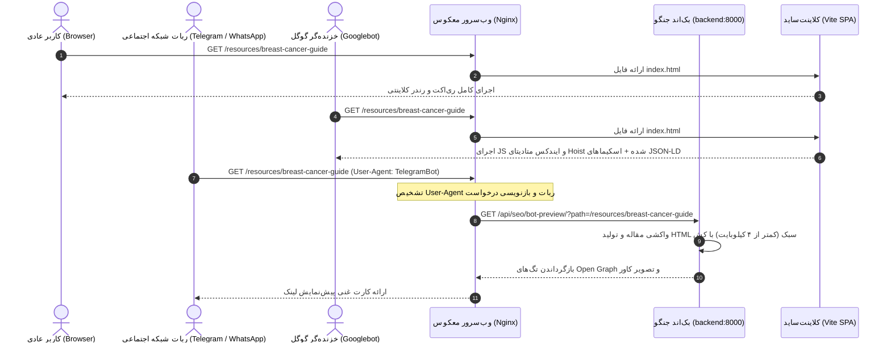

# راهنمای جامع معماری و پیاده‌سازی سئو در بک‌اند — کلینیک کملین
> **Implementation update — 2026-10-19:** the [current implementation contract](backend-seo-implementation.md)
> supersedes the examples below. By user decision, category sitemap entries are omitted,
> previews are restricted to public pages/published articles, and metadata changes take
> effect immediately. Nginx uses named-location dispatch and escaped Django templates
> replace interpolated HTML. Future alt-text and triage-export proposals are out of scope.

## Backend Architecture & Implementation Specification: Dynamic SEO, Sitemaps, Bot Proxying & Chat Privacy

> **ماژول:** سئو، نقشه سایت، متادیتای پیش‌نمایش شبکه‌های اجتماعی و حفاظت از بودجه خزش (`backend_core` & DevOps)  
> **مخاطب:** تیم توسعه بک‌اند پایتون/جنگو و مدیر سیستم / دوآپس (Nginx)  
> **هدف:** تدوین مشخصات دقیق فنی، قراردادهای داده، فایل‌های پیکربندی و کدهای آماده پیاده‌سازی در لایه بک‌اند جنگو و وب‌سرور Nginx برای سئوی دینامیک، نقشه سایت، پیش‌نمایش شبکه‌های اجتماعی و امنیت جلسات چت.  
> **وضعیت سند:** 📝 مصوب معماری — آماده پیاده‌سازی ایزوله و مستقل (Standalone Backend Spec)

---

## ۱. چرایی و معماری هیبریدی سئو (Hybrid CSR SEO Architecture)

وب‌سایت کملین دارای فرانت‌اند **React (Vite) Single Page Application** و بک‌اند **Django REST Framework** است. با توجه به اینکه بازنویسی فرانت‌اند به SSR (نظیر Next.js) مستلزم تحمیل بار پردازشی سنگین به سرور، وابستگی به نودجی‌اس در پروداکشن، ریسک تداخل با استیت‌منیجرهای کلاینتی و خطر بازگشت باگ‌ها (Regression) است، از **معماری هیبریدی سئو (Hybrid CSR SEO Architecture)** استفاده می‌شود.

### تفاوت رفتار خزنده‌ها و ربات‌ها:
1. **موتورهای جستجوی پیشرفته (Googlebot و Bingbot):**  
   مجهز به رندرر کرومیوم (WRS) بوده و قادرند کدهای جاوااسکریپت و متادیتای درج‌شده در DOM توسط فرانت کلاینت‌ساید را به درستی اجرا و ایندکس کنند.
2. **ربات‌های شبکه‌های اجتماعی و پیام‌رسان‌ها (Telegram, WhatsApp, Twitter, LinkedIn, Bale):**  
   فاقد مفسر جاوااسکریپت هستند. آن‌ها صرفاً HTML خام اولیه را واکشی کرده و تگ‌های Open Graph و Twitter Card را از بخش `<head>` می‌خوانند. در حالت عادی برنامه‌های تک‌صفحه‌ای (SPA)، این ربات‌ها فایل خالی `index.html` را دریافت کرده و کارت پیش‌نمایش لینک (عکس کاور، تیتر و خلاصه) نمایش داده نمی‌شود.
3. **خطر نشت حریم خصوصی چت‌بات و هدررفت بودجه خزش (Crawl Budget):**  
   طبق الزامات حفاظت از داده‌های پزشکی و استانداردهای گوگل، لینک‌ها یا نشست‌های چت‌بات تریاژ پزشکی نباید توسط موتورهای جستجو ایندکس شوند تا از نشت داده‌های بیماران و ایجاد صفحات کم‌محتوا (Thin Pages) جلوگیری گردد.



---

## ۲. وضعیت فعلی کدبیس بک‌اند و نیازمندی‌های تغییر (Backend Audit)

پس از بازرسی کدهای موجود در مخزن `backend_core`، وضعیت فعلی و نیازمندی‌های اصلاحی به شرح زیر است:

| بخش | وضعیت فعلی در کد | اقدام لازم جهت سئو |
| :--- | :--- | :--- |
| **`settings.py` - برنامه‌ها** | اپلیکیشن `django.contrib.sitemaps` فعال نیست. | افزودن `'django.contrib.sitemaps'` به لیست `DJANGO_APPS`. |
| **`settings.py` - تمپلیت‌ها** | آرایه `'DIRS': []` در بخش `TEMPLATES` خالی است. | اضافه کردن `BASE_DIR / 'templates'` به `DIRS` تا فایل `robots.txt` خوانده شود. |
| **دامنه سایت (`SITE_DOMAIN`)** | در `settings.py` وجود ندارد. | تعریف متغیر با مقدار پیش‌فرض `https://drnegarmashoori.ir` برای تولید لینک‌های مطلق. |
| **اپلیکیشن مقالات (`apps.articles`)** | مدل‌های `Article` و `Category` فیلدهای لازم را دارند، اما فایلی به نام `sitemaps.py` وجود ندارد. | ایجاد `backend_core/apps/articles/sitemaps.py` برای تولید نقشه سایت مقالات و صفحات ثابت. |
| **فایل راهنمای ربات‌ها** | تمپلیت و اندپوینت `robots.txt` در پروژه تعریف نشده است. | ایجاد `backend_core/templates/robots.txt` با دستور مسدودسازی نشست‌های چت‌بات. |
| **سرویس پیش‌نمایش شبکه‌های اجتماعی** | وجود ندارد. | ایجاد `backend_core/apps/articles/seo_views.py` به همراه کش حافظه‌ای. |
| **روت‌های اصلی (`config/urls.py`)** | روت‌های `/sitemap.xml`، `/robots.txt` و `/api/seo/bot-preview/` وجود ندارند. | الحاق روت‌ها به انتهای `urlpatterns`. |
| **کانفیگ سرور (`nginx.conf`)** | پروکسی برای تشخیص ربات‌ها وجود ندارد و همه درخواست‌ها به `index.html` می‌روند. | افزودن بلوک شرطی بر اساس هدر `User-Agent`. |

---

## ۳. تغییرات تنظیمات در `backend_core/config/settings.py`

### ۳.۱. فعال‌سازی پکیج نقشه سایت و تنظیم مسیر تمپلیت‌ها
فایل `backend_core/config/settings.py` باید به شرح زیر به‌روزرسانی شود:

```python
# backend_core/config/settings.py

# ۱. افزودن اپلیکیشن سیت‌مپ جنگو به اپ‌های پیش‌فرض
DJANGO_APPS = [
    'django.contrib.admin',
    'django.contrib.auth',
    'django.contrib.contenttypes',
    'django.contrib.sessions',
    'django.contrib.messages',
    'django.contrib.staticfiles',
    'django.contrib.sitemaps',  # <--- الزامی جهت فعال‌سازی sitemap.xml
]

# ۲. دامنه اصلی سایت جهت تولید URLهای مطلق در نقشه سایت و اپن‌گراف
SITE_DOMAIN = config('SITE_DOMAIN', default='https://drnegarmashoori.ir').rstrip('/')

# ۳. اصلاح مسیر جستجوی تمپلیت‌ها جهت شناسایی robots.txt
TEMPLATES = [
    {
        'BACKEND': 'django.template.backends.django.DjangoTemplates',
        'DIRS': [BASE_DIR / 'templates'],  # <--- اصلاح: افزودن مسیر templates
        'APP_DIRS': True,
        'OPTIONS': {
            'context_processors': [
                'django.template.context_processors.debug',
                'django.template.context_processors.request',
                'django.contrib.auth.context_processors.auth',
                'django.contrib.messages.context_processors.messages',
            ],
        },
    },
]
```

---

## ۴. پیاده‌سازی سورس‌های نقشه سایت (`apps/articles/sitemaps.py`)

فایل جدیدی در مسیر `backend_core/apps/articles/sitemaps.py` ایجاد می‌شود تا نقشه سایت مقالات منتشرشده و صفحات استاتیک عمومی را طبق استانداردهای گوگل به صورت داینامیک بسازد:

```python
# backend_core/apps/articles/sitemaps.py
from django.contrib.sitemaps import Sitemap
from django.conf import settings
from .models import Article, Category


class ArticleSitemap(Sitemap):
    """
    نقشه سایت برای مقالات منتشرشده کلینیک پزشکی
    """
    changefreq = "weekly"
    priority = 0.8
    protocol = "https"

    def items(self):
        # فقط مقالات با وضعیت منتشرشده انتخاب می‌شوند
        # برای بهبود پرفورمنس دیتابیس از select_related استفاده می‌شود
        return (
            Article.objects.filter(status=Article.PUBLISHED)
            .select_related("category", "author")
            .order_by("-published_at", "-updated_at")
        )

    def lastmod(self, obj):
        # تاریخ آخرین تغییرات مقاله برای اعلام به خزنده‌گر گوگل
        return obj.updated_at or obj.published_at or obj.created_at

    def location(self, obj):
        # آدرس صفحه در فرانت کلاینت‌ساید
        return f"/resources/{obj.slug}"


class CategorySitemap(Sitemap):
    """
    نقشه سایت برای دسته‌بندی‌های موضوعی مقالات کلینیک
    """
    changefreq = "monthly"
    priority = 0.6
    protocol = "https"

    def items(self):
        return Category.objects.all().order_by("name")

    def location(self, obj):
        return f"/resources?category={obj.slug}"


class StaticViewSitemap(Sitemap):
    """
    نقشه سایت برای صفحات ثابت، لندینگ‌ها و خدمات بالینی کلینیک
    """
    protocol = "https"

    PAGES = [
        {"location": "/", "priority": 1.0, "changefreq": "daily"},
        {"location": "/about", "priority": 0.9, "changefreq": "monthly"},
        {"location": "/services/therapeutic", "priority": 0.9, "changefreq": "monthly"},
        {"location": "/services/aesthetic", "priority": 0.9, "changefreq": "monthly"},
        {"location": "/faq", "priority": 0.8, "changefreq": "weekly"},
        {"location": "/resources", "priority": 0.8, "changefreq": "daily"},
        {"location": "/videos", "priority": 0.7, "changefreq": "weekly"},
    ]

    def items(self):
        return self.PAGES

    def location(self, item):
        return item["location"]

    def priority(self, item):
        return item["priority"]

    def changefreq(self, item):
        return item["changefreq"]
```

---

## ۵. پیاده‌سازی فایل `robots.txt` (با محافظت حریم چت‌بات)

ربات‌های خزنده‌گر نباید به مسیرهای خصوصی جلسات چت یا پنل‌های ادمین دسترسی پیدا کنند تا از نشت اطلاعات حساس سلامت بیماران (HIPAA / GDPR / داده‌های بالینی) و ایجاد صفحات کم‌محتوا در نتایج سرچ ممانعت به عمل آید.

### فایل `backend_core/templates/robots.txt`:
```text
User-agent: *

# بخش‌های خصوصی، ادمین و احراز هویت
Disallow: /admin/
Disallow: /api/admin/
Disallow: /api/auth/
Disallow: /api/users/

# حفاظت از نشست‌های چت‌بات تریاژ پزشکی و جلوگیری از ایندکس صفحات کم‌محتوا (Thin Pages)
Disallow: /chat-session/
Disallow: /api/chat/
Disallow: /api/chat_gateway/

# دسترسی‌های مجاز برای خزش محتوا و مقالات
Allow: /
Allow: /resources/
Allow: /services/
Allow: /about
Allow: /faq
Allow: /videos
Allow: /media/

# معرفی نقشه سایت به موتورهای جستجو
Sitemap: https://drnegarmashoori.ir/sitemap.xml
```

---

## ۶. سرویس پیش‌نمایش شبکه‌های اجتماعی (`apps/articles/seo_views.py`)

این کنترلر زمان فراخوانی لینک مقاله یا سایت در شبکه‌های اجتماعی (تلگرام، واتساپ، بله، ایتا، توییتر) توسط وب‌سرور Nginx فراخوانی شده و یک HTML فوق‌العاده سبک با هدرهای Open Graph استاندارد برمی‌گرداند.

فایل `backend_core/apps/articles/seo_views.py`:

```python
# backend_core/apps/articles/seo_views.py
from django.http import HttpResponse
from django.conf import settings
from django.views.decorators.cache import cache_page
from .models import Article

# کش ۱۵ دقیقه‌ای در حافظه برای جلوگیری از بمباران دیتابیس در زمان فوروارد وایرال لینک در گروه‌ها
@cache_page(60 * 15)
def bot_preview_view(request):
    """
    سرویس سبک جهت تولید تگ‌های Open Graph و Twitter Card برای خزنده‌های فاقد جاوااسکریپت
    """
    path = request.GET.get('path', '').strip()
    site_domain = getattr(settings, 'SITE_DOMAIN', 'https://drnegarmashoori.ir').rstrip('/')
    
    default_title = "کلینیک تخصصی پستان دکتر نگار معشوری"
    default_desc = "ارائه خدمات تخصصی جراحی پستان، انکوپلاستی، غربالگری و درمان بیماری‌های پستان توسط دکتر نگار معشوری."
    default_image = f"{site_domain}/pink-ribbon.svg"

    # ۱. سناریوی مقالات (/resources/<slug> یا /articles/<slug>)
    if path.startswith('/resources/') or path.startswith('/articles/'):
        slug = path.rstrip('/').split('/')[-1]
        try:
            article = Article.objects.select_related('author', 'category').get(
                slug=slug, 
                status=Article.PUBLISHED
            )
            title = f"{article.title} | {default_title}"
            description = article.excerpt or default_desc
            image_url = (
                request.build_absolute_uri(article.cover_image.url) 
                if article.cover_image 
                else default_image
            )
            canonical_url = f"{site_domain}/resources/{article.slug}"

            html_content = f"""<!DOCTYPE html>
<html lang="fa" dir="rtl">
<head>
    <meta charset="utf-8">
    <title>{title}</title>
    <meta name="description" content="{description}">
    <link rel="canonical" href="{canonical_url}">

    <!-- Open Graph (Telegram, WhatsApp, Facebook) -->
    <meta property="og:type" content="article">
    <meta property="og:site_name" content="{default_title}">
    <meta property="og:url" content="{canonical_url}">
    <meta property="og:title" content="{article.title}">
    <meta property="og:description" content="{description}">
    <meta property="og:image" content="{image_url}">

    <!-- Twitter Card -->
    <meta name="twitter:card" content="summary_large_image">
    <meta name="twitter:title" content="{article.title}">
    <meta name="twitter:description" content="{description}">
    <meta name="twitter:image" content="{image_url}">
</head>
<body>
    <h1>{article.title}</h1>
    <p>{description}</p>
</body>
</html>"""
            return HttpResponse(html_content, content_type="text/html; charset=utf-8")
        except Article.DoesNotExist:
            return HttpResponse("صفحه مورد نظر در کلینیک یافت نشد.", status=404, content_type="text/plain; charset=utf-8")

    # ۲. سناریوی صفحات ثابت، خدمات و صفحه اصلی
    html_fallback = f"""<!DOCTYPE html>
<html lang="fa" dir="rtl">
<head>
    <meta charset="utf-8">
    <title>{default_title}</title>
    <meta name="description" content="{default_desc}">
    <meta property="og:site_name" content="{default_title}">
    <meta property="og:type" content="website">
    <meta property="og:url" content="{site_domain}{path}">
    <meta property="og:title" content="{default_title}">
    <meta property="og:description" content="{default_desc}">
    <meta property="og:image" content="{default_image}">
    <meta name="twitter:card" content="summary">
</head>
<body>
    <h1>{default_title}</h1>
</body>
</html>"""
    return HttpResponse(html_fallback, content_type="text/html; charset=utf-8")
```

---

## ۷. رجیستر کردن روت‌ها در `backend_core/config/urls.py`

فایل `backend_core/config/urls.py` با اضافه شدن مسیرهای نقشه سایت، روبوتس و پیش‌نمایش تکمیل می‌گردد:

```python
# backend_core/config/urls.py
from django.conf import settings
from django.conf.urls.static import static
from django.contrib import admin
from django.contrib.sitemaps.views import sitemap
from django.urls import path, include
from django.views.generic import TemplateView

# ایمپورت کلاس‌های نقشه سایت و ویوی سئو
from apps.articles.sitemaps import ArticleSitemap, CategorySitemap, StaticViewSitemap
from apps.articles.seo_views import bot_preview_view

sitemaps = {
    'articles': ArticleSitemap,
    'categories': CategorySitemap,
    'static': StaticViewSitemap,
}

urlpatterns = [
    path('admin/', admin.site.urls),
    path("api/admin/articles/", include("apps.articles.admin_urls")),
    path("api/admin/", include("apps.appointments.admin_urls")),
    path("api/admin/", include("apps.chat_gateway.admin_urls")),
    path("api/admin/reviews/", include("apps.comments.review_admin_urls")),
    path("api/admin/", include("apps.common.admin_urls")),
    path("api/admin/", include("apps.users.admin_urls")),
    path("api/", include("apps.users.urls")),
    path("api/articles/", include("apps.articles.urls")),
    path("api/appointments/", include("apps.appointments.urls")),
    path("api/reviews/", include("apps.comments.review_urls")),
    path("api/chat/", include("apps.chat_gateway.urls")),
    path("api/", include("apps.common.urls")),

    # ── اندپوینت‌های اختصاصی سئو و خزنده‌ها ────────────────────────
    path('sitemap.xml', sitemap, {'sitemaps': sitemaps}, name='django.contrib.sitemaps.views.sitemap'),
    path('robots.txt', TemplateView.as_view(template_name="robots.txt", content_type="text/plain")),
    path('api/seo/bot-preview/', bot_preview_view, name='seo_bot_preview'),
]

if settings.DEBUG:
    urlpatterns += static(settings.MEDIA_URL, document_root=settings.MEDIA_ROOT)
```

---

## ۸. پیکربندی وب‌سرور معکوس (`nginx.conf`)

فایل کانفیگ وب‌سرور (`nginx.conf`) به گونه‌ای پیکربندی می‌شود که ترافیک ربات‌ها شناسایی و رهگیری شود:

```nginx
# nginx.conf (Reverse Proxy Configuration)

server {
    listen 80;
    server_name _;

    root /usr/share/nginx/html;
    index index.html;

    # ۱. مسیر ویژه نقشه سایت و فایل ربات‌ها (هدایت مستقیم به جنگو)
    location = /sitemap.xml {
        proxy_pass http://backend:8000/sitemap.xml;
        proxy_set_header Host $http_host;
    }

    location = /robots.txt {
        proxy_pass http://backend:8000/robots.txt;
        proxy_set_header Host $http_host;
    }

    # ۲. روت عمومی صفحات فرانت با تشخیص ربات‌های پیام‌رسان
    location / {
        set $is_bot 0;

        # تشخیص بات‌های پیام‌رسان که نیاز به رندر تگ‌های اولیه دارند
        if ($http_user_agent ~* "telegram|whatsapp|twitterbot|facebookexternalhit|linkedinbot|slackbot|discordbot|baiduspider") {
            set $is_bot 1;
        }

        # در صورت تطابق، درخواست به سرویس سبک پیش‌نمایش جنگو ری‌رایت می‌شود
        if ($is_bot = 1) {
            rewrite ^(.*)$ /api/seo/bot-preview/?path=$1 break;
            proxy_pass http://backend:8000;
            proxy_set_header Host $http_host;
            proxy_set_header X-Real-IP $remote_addr;
            proxy_set_header X-Forwarded-For $proxy_add_x_forwarded_for;
            proxy_set_header X-Forwarded-Proto $scheme;
        }

        # برای کاربران عادی و گوگل‌بات، فایل SPA کلاینتی لود می‌شود
        try_files $uri $uri/ /index.html;
    }

    # ۳. پروکسی اندپوینت‌های API جنگو
    location /api/ {
        proxy_pass http://backend:8000;
        proxy_set_header Host $http_host;
        proxy_set_header X-Real-IP $remote_addr;
        proxy_set_header X-Forwarded-For $proxy_add_x_forwarded_for;
        proxy_set_header X-Forwarded-Proto $scheme;
    }

    # ۴. فایل‌های چندرسانه‌ای (کاور مقالات و تصاویر بهینه‌شده)
    location /media/ {
        proxy_pass http://backend:8000;
        proxy_set_header Host $http_host;
        proxy_set_header X-Real-IP $remote_addr;
        proxy_set_header X-Forwarded-For $proxy_add_x_forwarded_for;
        proxy_set_header X-Forwarded-Proto $scheme;
    }
}
```

---

## ۹. توسعه‌های آینده‌نگرانه بک‌اند برای E-E-A-T و چرخه محتوا (Flywheel)

جهت ارتقای بیشتر رتبه پزشکی (E-E-A-T) و کشف کلمات کلیدی بیماران، دو قابلیت تکمیلی زیر پیشنهاد می‌شوند:

### ۹.۱. فیلد `cover_image_alt` در مدل `Article`
جهت تقویت سئوی تصاویر گوگل (Google Images) و دسترس‌پذیری:
```python
# در مایگریشن بعدی apps.articles
cover_image_alt = models.CharField(
    max_length=255, 
    blank=True, 
    default="", 
    verbose_name="متن جایگزین تصویر کاور (Alt Text)"
)
```

### ۹.۲. دستور مدیریتی استخراج کوئری‌های تریاژ (Chatbot Content Flywheel)
پرسش‌های ثبت‌شده بیماران در چت‌بات تریاژ، منبع غنی از نیازهای واقعی و کلمات کلیدی بلند (Long-tail Keywords) هستند. می‌توان با ساخت یک کامند جنگو (`apps/chat_gateway/management/commands/export_triage_topics.py`)، بدون ثبت هیچ‌گونه اطلاعات هویتی و شماره موبایل (PII/PHI)، پرسش‌های پرتکرار چت‌بات را استخراج کرد تا تیم محتوا بر مبنای آن‌ها مقالات پاسخ به سوالات بیماران را منتشر کنند.

---

## ۱۰. دستورالعمل تست و راستی‌آزمایی بک‌اند (Verification cURL Recipes)

پس از اعمال تغییرات در کانتینر یا محیط سرور، دستورات زیر در خط فرمان اجرا می‌شوند:

### ۱. تست استاتوس و محتوای `robots.txt`:
```bash
curl -i http://localhost:8000/robots.txt
# انتظار: HTTP 200 OK
# متن حاوی Disallow: /chat-session/ و Sitemap: https://drnegarmashoori.ir/sitemap.xml
```

### ۲. تست ساختار XML نقشه سایت:
```bash
curl -i http://localhost:8000/sitemap.xml
# انتظار: HTTP 200 OK
# بازگشت تگ‌های استاندارد <urlset> شامل صفحات ثابت و مقالات /resources/<slug>
```

### ۳. شبیه‌سازی بات تلگرام برای یک مقاله:
```bash
curl -i -A "TelegramBot (like TwitterBot)" "http://localhost:8000/api/seo/bot-preview/?path=/resources/my-article-slug"
# انتظار: بازگشت کدهای سبک HTML شامل og:title، og:description و og:image مقاله
```

### ۴. شبیه‌سازی کاربر عادی روی وب‌سرور:
```bash
curl -i -A "Mozilla/5.0" http://localhost:80/resources/my-article-slug
# انتظار: بازگشت فایل کامل index.html ری‌اکت حاوی تگ <div id="root">
```
