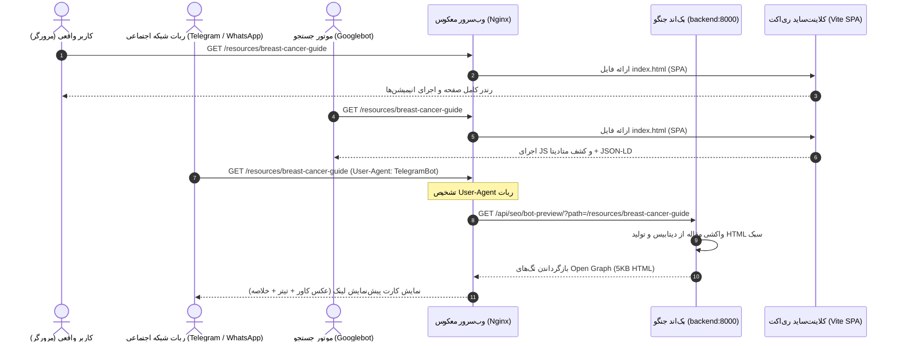

# راهنمای جامع معماری و پیاده‌سازی سئو در بک‌اند — کلینیک کملین
## Backend Architecture & Implementation Specification: Dynamic SEO, Sitemaps & Social Bot Proxying

> **مخاطب:** تیم توسعه بک‌اند (`backend_core`) و مدیریت زیرساخت (DevOps / Nginx)  
> **هدف:** تدوین مشخصات دقیق فنی، قراردادهای داده، فایل‌های پیکربندی و کدهای لازم در لایه بک‌اند جنگو و وب‌سرور Nginx برای دستیابی به بالاترین استاندارد سئو بدون نیاز به مهاجرت به SSR.  
> **وضعیت سند:** 📝 آماده پیاده‌سازی (Spec-Driven Approved)

---

## ۱. چرایی و معماری هیبریدی سئو (Hybrid CSR SEO Architecture)

وب‌سایت کملین دارای فرانت‌اند **React (Vite) Single Page Application** و بک‌اند **Django REST Framework** است. از آن‌جا که بازنویسی فرانت‌اند به SSR (مانند Next.js) مستلزم بار پردازشی سرور بالا، تداخل با کتابخانه‌های کلاینتی (Zustand، Recharts، Swiper) و خطر رگرسیون است، از **معماری هیبریدی (Hybrid CSR SEO)** استفاده می‌شود:

1. **موتورهای جستجوی مدرن (Googlebot & Bingbot):**  
   مجهز به رندرر کرومیوم (WRS) هستند و کدهای جاوااسکریپت و متادیتای DOM تولیدشده توسط فرانت کلاینت‌ساید را اجرا و ایندکس می‌کنند.
2. **ربات‌های شبکه‌های اجتماعی و پیام‌رسان‌ها (Telegram, WhatsApp, Twitter, LinkedIn):**  
   فاقد مفسر جاوااسکریپت بوده و تنها HTML خام اولیه را برای استخراج تگ‌های Open Graph و Twitter Card می‌خوانند.
3. **راهکار:** وب‌سرور **Nginx** درخواست‌های ورودی از این ربات‌ها را شناسایی کرده و به صورت هوشمند به یک اندپوینت سبک در جنگو (`/api/seo/bot-preview/`) پروکسی می‌کند تا پیش‌نمایش کارت لینک (Link Preview) با عکس و تیتر کامل در تلگرام و واتساپ نمایش داده شود.



---

## ۲. فعال‌سازی نقشه سایت و تنظیمات در `settings.py`

### ۲.۱. نیازمندی‌های اپلیکیشن در `backend_core/config/settings.py`
فریمورک نقشه سایت جنگو به صورت پیش‌فرض در خود جنگو قرار دارد و نیاز به نصب هیچ پکیج اضافه‌ای در `requirements.txt` ندارد:

```python
# backend_core/config/settings.py

DJANGO_APPS = [
    'django.contrib.admin',
    'django.contrib.auth',
    'django.contrib.contenttypes',
    'django.contrib.sessions',
    'django.contrib.messages',
    'django.contrib.staticfiles',
    'django.contrib.sitemaps',  # <--- الزامی برای نقشه سایت
]

# دامنه اصلی سایت جهت تولید لینک‌های مطلق در نقشه سایت و اپن‌گراف
SITE_DOMAIN = config('SITE_DOMAIN', default='https://kamelion.ir')
```

---

## ۳. پیاده‌سازی سورس‌های نقشه سایت (`sitemaps.py`)

یک فایل جدید در مسیر `backend_core/apps/articles/sitemaps.py` ایجاد می‌شود:

```python
# backend_core/apps/articles/sitemaps.py
from django.contrib.sitemaps import Sitemap
from django.conf import settings
from .models import Article

class ArticleSitemap(Sitemap):
    """
    نقشه سایت برای مقالات منتشر شده کلینیک
    """
    changefreq = "weekly"
    priority = 0.8
    protocol = "https"

    def items(self):
        # فقط مقالات تایید و منتشر شده باید در نقشه سایت قرار گیرند
        return (
            Article.objects.filter(status=Article.PUBLISHED)
            .select_related("category", "author")
            .order_by("-published_at")
        )

    def lastmod(self, obj):
        # تاریخ آخرین ویرایش برای اعلام به ربات گوگل
        return obj.updated_at

    def location(self, obj):
        # مسیر صفحه در فرانت‌اند
        return f"/resources/{obj.slug}"


class StaticViewSitemap(Sitemap):
    """
    نقشه سایت برای روت‌های عمومی و صفحات استاتیک فرانت‌اند
    """
    protocol = "https"

    PAGES = [
        {"location": "/", "priority": 1.0, "changefreq": "daily"},
        {"location": "/about", "priority": 0.9, "changefreq": "monthly"},
        {"location": "/services/therapeutic", "priority": 0.9, "changefreq": "monthly"},
        {"location": "/services/aesthetic", "priority": 0.9, "changefreq": "monthly"},
        {"location": "/faq", "priority": 0.8, "changefreq": "weekly"},
        {"location": "/resources", "priority": 0.8, "changefreq": "daily"},
        {"location": "/videos", "priority": 0.7, "changefreq": "weekly"},
    ]

    def items(self):
        return self.PAGES

    def location(self, item):
        return item["location"]

    def priority(self, item):
        return item["priority"]

    def changefreq(self, item):
        return item["changefreq"]
```

---

## ۴. پیاده‌سازی فایل `robots.txt`

موتورهای جستجو باید بدانند چه بخش‌هایی عمومی هستند و چه بخش‌هایی (مانند پنل ادمین کلینیک یا مسیرهای احراز هویت داخلی) نباید خزش شوند.

### ۴.۱. ایجاد تمپلیت `robots.txt`
فایل `backend_core/templates/robots.txt`:
```text
User-agent: *
Disallow: /admin/
Disallow: /api/admin/
Disallow: /api/auth/
Allow: /
Allow: /api/articles/
Allow: /media/

Sitemap: https://kamelion.ir/sitemap.xml
```

---

## ۵. توسعه سرویس سبک پیش‌نمایش شبکه‌های اجتماعی (`bot_preview`)

این کنترلر زمانی اجرا می‌شود که لینک یک مقاله در تلگرام، واتساپ، بله یا توییتر کپی و ارسال شود. این ویو با حداقل بار ممکن فقط هد HTML معتبر تولید می‌کند.

### ۵.۱. ویو در `backend_core/apps/articles/seo_views.py`
```python
# backend_core/apps/articles/seo_views.py
from django.http import HttpResponse, Http404
from django.shortcuts import get_object_or_404
from django.conf import settings
from django.views.decorators.cache import cache_page
from .models import Article

# کش کردن خروجی برای جلوگیری از کوئری مکرر دیتابیس در صورت فوروارد گسترده در گروه‌ها
@cache_page(60 * 15)  # ۱۵ دقیقه کش در حافظه
def bot_preview_view(request):
    """
    سرویس تولید متاتگ‌های Open Graph برای ربات‌های پیام‌رسان
    """
    path = request.GET.get('path', '').strip()
    site_domain = getattr(settings, 'SITE_DOMAIN', 'https://kamelion.ir').rstrip('/')
    default_title = "کلینیک تخصصی پستان دکتر نگار معشوری"
    default_desc = "ارائه خدمات تخصصی جراحی پستان، انکوپلاستی، غربالگری و درمان بیماری‌های پستان"
    default_image = f"{site_domain}/pink-ribbon.svg"

    # ۱. سناریوی صفحه جزئیات مقاله (/resources/<slug> یا /articles/<slug>)
    if path.startswith('/resources/') or path.startswith('/articles/'):
        slug = path.rstrip('/').split('/')[-1]
        try:
            article = Article.objects.select_related('author').get(
                slug=slug, 
                status=Article.PUBLISHED
            )
            title = f"{article.title} | {default_title}"
            description = article.excerpt or default_desc
            image_url = (
                request.build_absolute_uri(article.cover_image.url) 
                if article.cover_image 
                else default_image
            )
            canonical_url = f"{site_domain}/resources/{article.slug}"

            html_content = f"""<!DOCTYPE html>
<html lang="fa" dir="rtl">
<head>
    <meta charset="utf-8">
    <title>{title}</title>
    <meta name="description" content="{description}">
    <link rel="canonical" href="{canonical_url}">

    <!-- Open Graph (Telegram, WhatsApp, Facebook) -->
    <meta property="og:type" content="article">
    <meta property="og:site_name" content="{default_title}">
    <meta property="og:url" content="{canonical_url}">
    <meta property="og:title" content="{article.title}">
    <meta property="og:description" content="{description}">
    <meta property="og:image" content="{image_url}">

    <!-- Twitter Card -->
    <meta name="twitter:card" content="summary_large_image">
    <meta name="twitter:title" content="{article.title}">
    <meta name="twitter:description" content="{description}">
    <meta name="twitter:image" content="{image_url}">
</head>
<body>
    <h1>{article.title}</h1>
    <p>{description}</p>
</body>
</html>"""
            return HttpResponse(html_content, content_type="text/html; charset=utf-8")
        except Article.DoesNotExist:
            return HttpResponse("صفحه مورد نظر یافت نشد.", status=404, content_type="text/plain; charset=utf-8")

    # ۲. سناریوی صفحات عمومی و پیش‌فرض
    html_fallback = f"""<!DOCTYPE html>
<html lang="fa" dir="rtl">
<head>
    <meta charset="utf-8">
    <title>{default_title}</title>
    <meta name="description" content="{default_desc}">
    <meta property="og:site_name" content="{default_title}">
    <meta property="og:title" content="{default_title}">
    <meta property="og:description" content="{default_desc}">
    <meta property="og:image" content="{default_image}">
    <meta name="twitter:card" content="summary">
</head>
<body>
    <h1>{default_title}</h1>
</body>
</html>"""
    return HttpResponse(html_fallback, content_type="text/html; charset=utf-8")
```

---

## ۶. رجیستر کردن روت‌ها در `backend_core/config/urls.py`

در فایل روت‌های اصلی بک‌اند مسیرهای سئو اضافه می‌گردند:

```python
# backend_core/config/urls.py
from django.contrib.sitemaps.views import sitemap
from django.views.generic import TemplateView
from apps.articles.sitemaps import ArticleSitemap, StaticViewSitemap
from apps.articles.seo_views import bot_preview_view

sitemaps = {
    'articles': ArticleSitemap,
    'static': StaticViewSitemap,
}

urlpatterns += [
    # نقشه سایت داینامیک
    path('sitemap.xml', sitemap, {'sitemaps': sitemaps}, name='django.contrib.sitemaps.views.sitemap'),
    
    # فایل راهنمای ربات‌ها
    path('robots.txt', TemplateView.as_view(template_name="robots.txt", content_type="text/plain")),
    
    # اندپوینت پیش‌نمایش شبکه‌های اجتماعی برای ربات‌ها
    path('api/seo/bot-preview/', bot_preview_view, name='seo_bot_preview'),
]
```

---

## ۷. پیکربندی وب‌سرور معکوس (`front-end/nginx.conf`)

فایل کانفیگ Nginx به گونه‌ای به‌روزرسانی می‌شود که درخواست‌های بات‌ها رهگیری شده و به جنگو هدایت شوند:

```nginx
# front-end/nginx.conf

server {
    listen 80;
    server_name _;

    root /usr/share/nginx/html;
    index index.html;

    # ۱. مسیر ویژه نقشه سایت و فایل ربات‌ها (هدایت مستقیم به جنگو)
    location = /sitemap.xml {
        proxy_pass http://backend:8000/sitemap.xml;
        proxy_set_header Host $http_host;
    }

    location = /robots.txt {
        proxy_pass http://backend:8000/robots.txt;
        proxy_set_header Host $http_host;
    }

    # ۲. روت عمومی صفحات فرانت به همراه تشخیص ربات‌های اجتماعی
    location / {
        set $is_bot 0;

        # تشخیص بات‌های پیام‌رسان بر اساس هدر User-Agent
        if ($http_user_agent ~* "telegram|whatsapp|twitterbot|facebookexternalhit|linkedinbot|slackbot|discordbot|baiduspider") {
            set $is_bot 1;
        }

        # در صورتی که ربات شبکه اجتماعی باشد، درخواست به جنگو ری‌رایت می‌شود
        if ($is_bot = 1) {
            rewrite ^(.*)$ /api/seo/bot-preview/?path=$1 break;
            proxy_pass http://backend:8000;
            proxy_set_header Host $http_host;
            proxy_set_header X-Real-IP $remote_addr;
            proxy_set_header X-Forwarded-For $proxy_add_x_forwarded_for;
            proxy_set_header X-Forwarded-Proto $scheme;
        }

        # برای کاربران عادی و گوگل‌بات، فایل SPA بارگذاری می‌شود
        try_files $uri $uri/ /index.html;
    }

    # ۳. پروکسی اندپوینت‌های API
    location /api/ {
        proxy_pass http://backend:8000;
        proxy_set_header Host $http_host;
        proxy_set_header X-Real-IP $remote_addr;
        proxy_set_header X-Forwarded-For $proxy_add_x_forwarded_for;
        proxy_set_header X-Forwarded-Proto $scheme;
    }

    # ۴. فایل‌های مدیا
    location /media/ {
        proxy_pass http://backend:8000;
        proxy_set_header Host $http_host;
        proxy_set_header X-Real-IP $remote_addr;
        proxy_set_header X-Forwarded-For $proxy_add_x_forwarded_for;
        proxy_set_header X-Forwarded-Proto $scheme;
    }
}
```

---

## ۸. چک‌لیست تست و راستی‌آزمایی بک‌اند (cURL Recipes)

پس از بالا آمدن سرویس‌ها با داکر یا محیط محلی، تست‌های زیر به عنوان راستی‌آزمایی نهایی انجام می‌شوند:

1. **بررسی صحت فایل `robots.txt`:**
   ```bash
   curl -i http://localhost:8080/robots.txt
   # خروجی مورد انتظار: استاتوس 200 و نمایش آدرس sitemap.xml
   ```
2. **بررسی ساختار XML نقشه سایت:**
   ```bash
   curl -i http://localhost:8080/sitemap.xml
   # خروجی مورد انتظار: ساختار استاندارد urlset و حاوی آدرس‌های /resources/<slug> با تاریخ lastmod
   ```
3. **تست شبیه‌سازی ربات تلگرام برای پیش‌نمایش مقاله:**
   ```bash
   curl -i -A "TelegramBot (like TwitterBot)" http://localhost:8080/resources/monthly-breast-self-exam-guide
   # خروجی مورد انتظار: بازگشت کدهای HTML خام حاوی og:image و og:title به جای فایل سنگین index.html
   ```
4. **تست شبیه‌سازی کاربر عادی برای همان مقاله:**
   ```bash
   curl -i -A "Mozilla/5.0 (Windows NT 10.0; Win64; x64)" http://localhost:8080/resources/monthly-breast-self-exam-guide
   # خروجی مورد انتظار: بازگشت فایل کلاینتی index.html ری‌اکت با تگ <div id="root">
   ```
