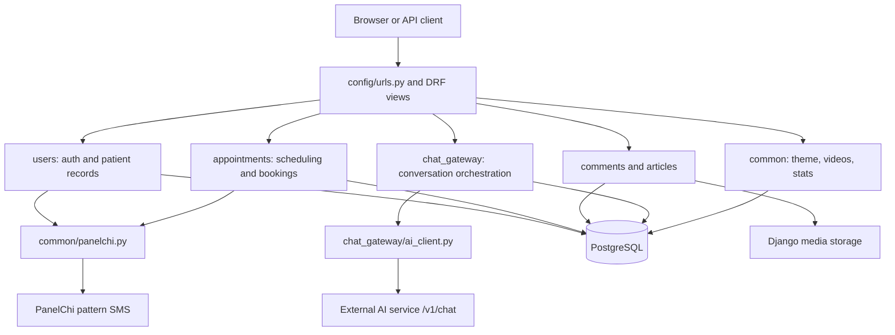

# Backend Architecture

> **Verified against repository source:** 2026-10-17, baseline commit `8b0eca0`.
> Scope: the current `backend_core` implementation. Operational configuration and
> external-service availability are separate from implementation status.

[API reference](api-endpoints.md) · [Backend feature status](../features/feature-status-back-end.md) · [Articles API](api-endpoints-articles.md) · [Chat/triage API](api-endpoints-chat.md)

## 1. Technology and runtime

| Area | Checked-in implementation |
|---|---|
| Runtime / framework | Python, Django (`django>=4.2`), DRF (`>=3.15`); Docker base `python:3.10-slim` |
| Authentication | SimpleJWT (`>=5.3`), refresh-token blacklist app; Django sessions for `/admin/` |
| Database | PostgreSQL through `psycopg2-binary`; Compose uses PostgreSQL 16 |
| Configuration | Single `config/settings.py`, environment values through `python-decouple` |
| Outbound HTTP | Synchronous `httpx` calls to the AI service and PanelChi |
| Content processing | `nh3` HTML sanitization, Pillow image validation/WebP conversion |
| Calendar formatting | `jdatetime` for Jalali SMS dates and dashboard labels |
| Serving | Gunicorn WSGI in Docker (3 workers); standard ASGI entry point also present |
| Browser access | `django-cors-headers`; checked-in CORS/CSRF origins are localhost:5173 and 127.0.0.1:5173 |

`requirements.txt` declares lower bounds, not a locked dependency set. `backend_core/package.json` contains a `dom` dependency and is not used by Django or its Docker runtime.

## 2. Application layout and responsibilities

```text
backend_core/
├── config/                    # settings, root URLs, WSGI/ASGI
├── apps/
│   ├── users/                 # phone login, registration, JWT lifecycle, patient dossiers/notes
│   ├── appointments/          # weekly availability, closures, booking, decisions, SMS notices
│   ├── comments/              # public reviews and staff moderation
│   ├── articles/              # article/category CMS and media processing
│   ├── chat_gateway/          # stored conversations, AI client, triage state/actions, admin history
│   └── common/                # theme, video gallery, dashboard statistics, shared PanelChi client
├── certs/                     # bundled public AI-service CA certificate
├── manage.py
├── requirements.txt
└── Dockerfile
```

All six apps are installed and routed. Neither `chat_gateway` nor `common` is an empty placeholder.

Models define schema/constraints; serializers define API fields and boundary validation. Views handle permissions and responses. Users, appointments, articles, and chat place reusable business logic in `services.py`; chat additionally separates `payload.py`, `ai_client.py`, `actions.py`, `constants.py`, and `texts.py`. Admin routes/views generally live beside their public counterparts. Common's public and admin theme/video views share `views.py`; analytics is in `stats_views.py` and SMS transport in `panelchi.py`.

This is a service-layer convention rather than an absolute rule: some views write directly to the ORM (patient notes, profile edits, review moderation, settings, and generic CRUD). There is no separate repository/DAO layer, task queue, or configured cache layer.

## 3. Routing and component relationships

`config/urls.py` mounts:

| Prefix | Included app URL configurations |
|---|---|
| `/admin/` | Django admin site |
| `/api/` | `users.urls`, `common.urls` |
| `/api/appointments/` | `appointments.urls` |
| `/api/reviews/` | `comments.review_urls` |
| `/api/articles/` | `articles.urls` |
| `/api/chat/` | `chat_gateway.urls` |
| `/api/admin/articles/` | `articles.admin_urls` |
| `/api/admin/reviews/` | `comments.review_admin_urls` |
| `/api/admin/` | `appointments.admin_urls`, `chat_gateway.admin_urls`, `common.admin_urls`, `users.admin_urls` |

The order of includes matters. Scheduling bulk routes precede its `DefaultRouter` routes; article categories precede the public string-slug route. The scheduling router also exposes API discovery and format suffixes. See the [API reference](api-endpoints.md) for exact paths, methods, access, and payloads.



Apps communicate through Python imports and shared ORM relations, rather than internal HTTP. Users' admin patient summaries query chat sessions; common statistics query appointments, reviews, and chat sessions. This couples those read models to their source apps without moving domain ownership.

## 4. Current data model

All ordinary primary keys use Django's default `BigAutoField`; `ChatSession.ai_session_id` is a separate UUID. Migrations are per app. There is no current `PatientProfile` model.

| App / model | Fields and relationships |
|---|---|
| users: `User` | Phone is unique and is the login identifier; nullable/blank `full_name`, intentionally non-unique nullable `national_id`, optional `sex` (female/male), optional birth date; staff/active/superuser flags |
| users: `OTPRequest` | Phone, code, created/expiry timestamps, used flag; default expiry 5 minutes |
| users: `PhoneVerification` | Verified phone, unique opaque signup token, expiry/used flag; default expiry 10 minutes |
| users: `PatientNote` | Patient FK with CASCADE; nullable author FK with SET_NULL; text and creation time |
| appointments: `DoctorAvailability` | Name, JSON day-code list, start/end, visit duration, time gap, active flag, timestamps; `save()` invokes `full_clean()` |
| appointments: `AvailabilityException` | Inclusive start/end closure dates and optional reason; database check `end_date >= start_date` |
| appointments: `Appointment` | User FK with CASCADE, date/time, reason, status, disapproval reason, timestamps |
| comments: `Review` | Name/email/text/rating, pending/approved/rejected status, optional user/reviewer FKs with SET_NULL, review/creation/update times |
| articles: `Category` | Unique name and Unicode slug, description, creation time |
| articles: `Article` | Title/Unicode slug/excerpt/HTML, cover image/video URL, nullable category and author FKs with SET_NULL, draft/published status, derived reading time, view count, publication/creation/update times |
| chat_gateway: `ChatSession` | Unique widget session key, unique AI UUID, nullable owner FK with SET_NULL, latest triage level/summary, timestamps |
| chat_gateway: `ChatMessage` | Session FK with CASCADE; user/assistant/backend role, backend-message kind, content/time |
| chat_gateway: `TriageAction` | Session FK with CASCADE, level, booking-offer/emergency-code kind, nullable unique emergency code, creation time |
| common: `SiteSetting` | Unique key/value; theme accessor defaults to pink when no stored row exists |
| common: `Video` | Title, source string, video/iframe type, creation time |

Users migration `0006` copied existing profile birth dates onto `User`, then deleted `PatientProfile`; its old address field is not part of the current dossier API.

Key indexes/constraints include unique phone/signup token/article slug/category names and slugs, expiry lookups, appointment date/time/status/user-date indexes, closure date-range index, article status/publication index, chat session/message index, and review status index.

`unique_scheduled_appointment_slot` retains its historical name but now applies to **both pending and scheduled** appointments at `(appointment_date, appointment_time)`. `uniq_triage_action_per_level` allows at most one action per `(session, level)`.

## 5. Authentication and patient records

DRF defaults to JWT authentication and `IsAuthenticated`. Public endpoints explicitly disable authentication. Admin resources use `IsAdminUser`, based on `is_staff`; views described as patient-facing generally use `IsAuthenticated`, without excluding staff. There are no custom business roles/scopes beyond the stock Django/DRF checks, although the user inherits Django's permission/group machinery.

Access tokens last 7 days; refresh tokens last 30 days. Refresh is explicit through `/api/auth/refresh` and reuses the refresh token. Logout can blacklist refresh tokens; existing access tokens remain valid until expiry.

Patient flow: request OTP → verify valid OTP → existing user receives JWTs, or new phone receives a 10-minute signup token → registration with name/national ID and optional sex/birth date creates the account and issues JWTs. Staff numbers are directed to password login before OTP generation. Patient login uses `access`/`refresh`; admin login and refresh use camelCase token keys. `GET /api/auth/me` restores current-user context. No patient self-edit endpoint is exposed.

Admins can list/search non-staff patients, retrieve dossiers, edit name/national ID, and add clinical notes. Dossiers include demographics, appointment history, and notes; chat history/triage have separate admin endpoints. Sex/birth date are collected at signup and returned in dossiers, but are not accepted by the admin update serializer.

## 6. Scheduling and decisions

Availability is computed from active weekly rules, inclusive closure ranges, and pending/scheduled bookings. No slot table is stored. Daily slot lookup, monthly unavailable-date lookup, and recurring weekly-hour spans are public. Weekly spans run Sunday–Saturday and do not include exceptions.

Patient booking is atomic and starts pending. Admin manual booking identifies/creates a user by phone, runs the same slot checks, and starts scheduled. Application availability checks plus the conditional unique constraint prevent duplicate active rows; a race raising `IntegrityError` is not explicitly mapped to a friendly API error.

Pending appointments can be approved to scheduled, rejected with a reason to cancelled_admin, or cancelled by their owner to cancelled_user. Owners can also cancel scheduled appointments. Dedicated admin decision endpoints validate pending status. The general admin detail endpoint permits broader field/status changes, treats PUT as partial, and does not re-run the booking service's weekly-hour/closure checks. Pending-to-decision updates also trigger SMS. Do not infer a strict state machine for every update route.

Bulk weekly schedules and closures are atomic upsert-and-prune operations: matching IDs update, omitted/unknown IDs create, and unreferenced existing rows are deleted. Their payload is the complete desired collection.

## 7. AI gateway and triage actions

The backend persists sessions/messages/triage and builds the AI request itself. It sends a generated UUID, current message, up to 100 earlier user/assistant messages, prior triage, and known first name/age/sex. Backend-generated fallback/code messages are excluded from AI history. Phone/national ID are not added to structured patient context; user message text is still forwarded.

Session ownership is enforced; legacy ownerless sessions can be adopted. The service stores the user message, then holds a database session-row lock across the synchronous AI call to serialize work. Superseded requests return 409. Successful replies persist the latest triage and staff-only summary; severity downgrades are rejected. Low/high levels offer normal booking; urgent generates a unique `URG-` code, without booking an appointment. Actions are recorded once per session/level and failed actions may be retried on later successful turns.

The HTTP client validates responses, uses a 30-second default timeout and one retry after 2 seconds for transport/retryable HTTP errors, and returns control to a fixed fallback on handled failures. HTTP 400/401 and malformed success responses are not retried. TLS verification uses the configured private CA or system trust. The API key is server-side. [Chat API details](api-endpoints-chat.md) cover fields, retries, and admin conversation access.

## 8. SMS and content integrations

PanelChi transport lives in `common/panelchi.py`. `SMS_PROVIDER=console` is the default; `panelchi` enables real sends. It converts local Iranian phone numbers to `+98` format and sends approved pattern slugs through `/sms/pattern`. OTP send failures delete the new OTP and return 502. Appointment approval/rejection sends use separate patterns and log provider failures without undoing the saved decision; dates are Jalali and rejection includes the reason.

Article HTML is sanitized with nh3; embedded videos are restricted to the allowed HTTPS Aparat/YouTube hosts. Cover/inline images are validated by content, extension, size (5 MiB), and dimensions (40 MP), then encoded as WebP with max width 1600. Publication time is stamped once; reading time is derived; public detail increments views. The [articles reference](api-endpoints-articles.md) is the current contract. Expanded article tags/revisions/review-workflow proposals are not implemented.

Theme/video resources are database-backed. Dashboard metrics aggregate visits, bookings, reviews, and chat sessions, but emergency-code totals remain a constant zero. Trend counts use Gregorian month boundaries with Jalali month labels, and the status chart compares visited with scheduled only.

## 9. Configuration and deployment

| Configuration group | Names / defaults |
|---|---|
| Core/database | Required `SECRET_KEY`, `DB_NAME`, `DB_USER`, `DB_PASSWORD`; `DB_HOST=localhost`, `DB_PORT=5432`; `DEBUG=False`; `ALLOWED_HOSTS=['*']` |
| AI | `AI_SERVICE_BASE_URL`, `AI_SERVICE_API_KEY`, bundled-path `AI_SERVICE_CA_BUNDLE`, `AI_SERVICE_TIMEOUT=30`, `AI_SERVICE_RETRY_DELAY=2`, `CLINIC_PHONE_NUMBER` |
| SMS | `SMS_PROVIDER=console`, `PANELCHI_BASE_URL=https://api.panelchi.com`, `PANELCHI_TIMEOUT=10`, `PANELCHI_SMS_TOKEN`, optional `PANELCHI_SOURCE_NUMBER`, login/approved/rejected pattern settings |
| Media/static | `MEDIA_ROOT=BASE_DIR/media`, `MEDIA_URL=/media/`, `STATIC_URL=/static/` |

The former `FASTAPI_BASE_URL`/`FASTAPI_TIMEOUT` settings are not present; the active client uses `AI_SERVICE_*`. AI system checks warn on missing configuration/CA files and non-HTTPS production URLs. Logging sends Django errors/tracebacks to the console even with DEBUG disabled.

Compose runs PostgreSQL, backend, and frontend/Nginx with persistent database/media volumes. PostgreSQL is published on host port 5433; frontend on 8080; backend is exposed internally on 8000. Nginx proxies `/api/` and `/media/` to the backend. Django adds media-serving routes only under DEBUG; production media serving needs a working serving arrangement beyond the current proxy when DEBUG is false. Docker's command starts Gunicorn; it does not automatically apply migrations or collect static files.

Django admin registers users/notes, schedules/closures/appointments, reviews, articles/categories, theme/videos, and chat sessions with read-only message/action inlines. Appointment bulk approval is available; bulk disapproval is absent because reasons are required.

## 10. Known implementation limits and verification

- No patient self-edit API, video update API, custom business-role system, task queue, or public patient chat-history endpoint is wired.
- Dashboard emergency-code counts do not yet query `TriageAction`, despite code issuance existing.
- Validation differs across generic versus service-driven writes: appointment detail bypasses availability rules; individual closure CRUD relies on a database date-order check; note creation does not apply its model text-length validator.
- Auth/login, AI/SMS availability, and media access depend on environment configuration; this source review did not check a deployment.
- The checked-in wildcard host setting and local-only CORS/CSRF lists are documented configuration, not evidence of production setup.
- AI source comments cite an external `API.md` contract not present in this checkout. Older article design guides are retained with historical/proposal notices.

This documentation revision used source inspection and Django URL resolution. Existing substantive tests cover users registration, articles, and mocked chat contracts/actions/admin APIs. The appointments/common test modules remain generated stubs. See [feature status](../features/feature-status-back-end.md#verification-and-maintenance) for the check scope; implementation status does not claim full regression coverage or live-service validation.
